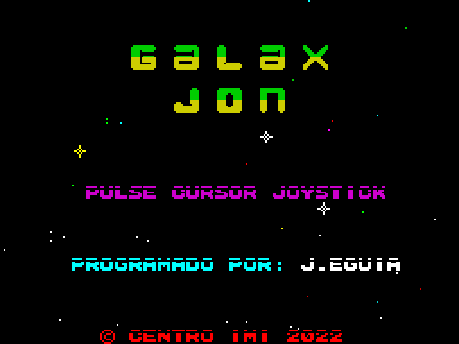
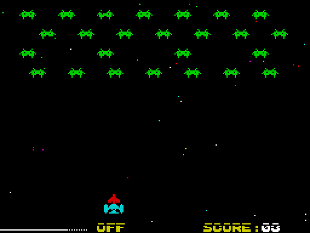
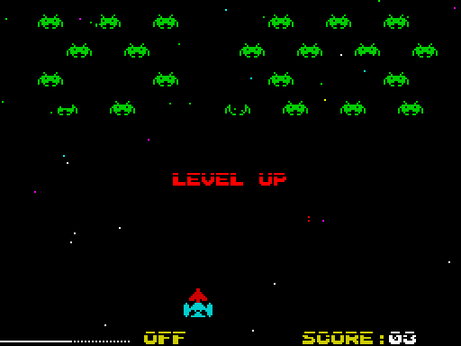

# Galax Jon v2

Matamarcianos al estilo *Space Invaders* para **ZX Spectrum 48K**, escrito íntegramente en **ensamblador Z80**.

Esta es la versión 2 del juego: el código original de un solo archivo se ha limpiado y reorganizado en módulos, con nuevas funciones (melodía en el menú y ESPACIO para empezar).

| Menú principal | Partida | Level Up |
|:---:|:---:|:---:|
|  |  |  |

## El juego

Una formación de 25 marcianos oscila en la parte superior de la pantalla. Tienes que abatirlos a todos con tu nave antes de que te alcancen sus disparos.

- **3 vidas.** Cada impacto enemigo hace explotar la nave y vuelve a la pausa de "PREPARADO...".
- **Niveles.** Al eliminar los 25 marcianos aparece "LEVEL UP" y la formación se reinicia. En cada nivel los marcianos empiezan a disparar antes, y a partir del nivel 3 el juego va más rápido. Cada nivel superado añade una banderita junto al marcador.
- **Cadencia de disparo.** La barra de la parte inferior izquierda indica cuándo puedes volver a disparar (ON / OFF).
- **Final.** Al llegar a 100 puntos se completa el juego ("ENHORABUENA!").

## Controles

| Acción | Tecla |
|---|---|
| Empezar partida (menú) | Cursor `5` `6` `7` `8` o `ESPACIO` |
| Izquierda | `5` |
| Derecha | `8` |
| Disparar | `6` o `7` |
| Otra partida (tras Game Over) | `ENTER` |

Son las teclas de cursor del Spectrum (`5` ←, `6` ↓, `7` ↑, `8` →). Se dispara con arriba o abajo.

## Compilar y ejecutar

Se ensambla con [Pasmo](https://pasmo.speccy.org/). Desde la carpeta del proyecto:

```bash
pasmo --tapbas main.asm tap/galax_jon.tap
```

Esto genera un `.tap` con cargador BASIC incluido, listo para abrir en cualquier emulador (Fuse, ZEsarUX, Spectaculator, etc.). El código se carga y arranca en `$8000`.

## Estructura del proyecto

`main.asm` contiene el arranque, el bucle principal y los `include` del resto de módulos.

| Archivo | Contenido |
|---|---|
| `main.asm` | `org $8000`, inicialización, bucle principal e includes |
| `constantes.asm` | Rutinas ROM, constantes, estructura de los marcianos y bits de `settings` |
| `texto.asm` | Impresión de cadenas y caracteres, relleno de atributos |
| `nave.asm` | Dibujo y borrado de la nave del jugador |
| `espacio.asm` | Scroll del fondo de estrellas y `next_scan` |
| `marcianos.asm` | Movimiento de los marcianos y sus disparos |
| `disparo.asm` | Disparo del jugador y detección de impactos |
| `explosion.asm` | Explosiones de los marcianos abatidos |
| `teclado.asm` | Lectura del teclado durante la partida |
| `menu.asm` | Menú principal: título, créditos, estrella animada |
| `estados.asm` | Game Over, final del juego, Level Up y pausa inicial |
| `score.asm` | Marcador y banderitas de nivel |
| `inicializacion.asm` | Reinicio de partida, atributos generales y CLS |
| `sonido.asm` | Efectos de sonido con el BEEPER de la ROM |
| `musica.asm` | Reproductor y melodía del menú |
| `textos.asm` | Todos los textos del juego |
| `graficos.asm` | Sprites (nave, marcianos, explosiones), letras del título, estrellas |
| `fuente.asm` | Fuente de 8x8 píxeles (ASCII 32–95) |
| `variables.asm` | Variables del juego y tabla de los 25 marcianos |

## Detalles técnicos

- **Textos.** La fuente está ordenada como el ASCII (del 32 al 95), así que cada carácter está en `fuente + (ASCII - 32) * 8` y los textos se escriben directamente: `defb "GAME OVER",0`. Algunos signos que el juego no usa contienen letras propias, como `[` para © o `;` `<` `=` `>` `?` para las vocales con tilde (ver `fuente.asm`).
- **Marcianos.** No cambian de casilla: su movimiento es una animación de 11 fotogramas de 3x1 caracteres desplazados un píxel cada uno. Al llegar al extremo cambian de sentido y de animación. Cada marciano es un registro de 7 bytes que se recorre con `IX` (`(ix+M_ACTIVO)`, `(ix+M_ROT)`...).
- **Melodía del menú.** El BEEPER de la ROM detiene la CPU mientras suena, así que cada nota dura solo 30 ms y luego se espera en silencio unas vueltas del bucle. En las vueltas con nota el menú hace un `HALT` en lugar de dos, para que la animación mantenga su ritmo. La melodía (Lam – Fa – Sol – Mi) está en una tabla editable en `musica.asm`.
- **Ritmo.** El juego se sincroniza con `HALT`. La variable `velocidad` controla cuántos se hacen por vuelta del bucle principal.

## Historia

- **v1:** versión original en un único archivo (`space_jon.asm`).
- **v2:** código limpiado y dividido en módulos, fuente indexada por ASCII, rutinas duplicadas unificadas, melodía en el menú y tecla ESPACIO para empezar. Durante la limpieza se comprobó en un emulador, fotograma a fotograma, que el comportamiento del juego no cambiaba.

## Créditos

- Programación: **J. Eguia** (Centro IMI, 2022)
- Autor de la fuente de texto *Javier Vispe*
- Gráficos creados con *SevenuP* (© Jaime Tejedor Gómez, "Metalbrain")
